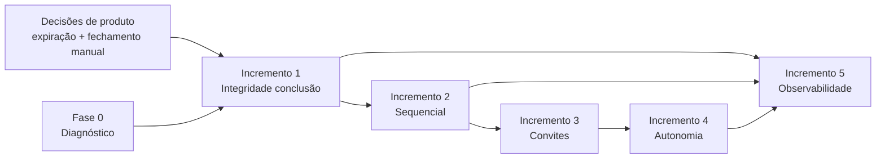

# 01 — Estratégia de Produto (Reliability First)

**Produto:** NexoSign / Connexto Digital Signer  
**Base de evidência:** Discovery 2026-11-02 (`reports/discovery/01`–`07`, revisão de código `37c8036`)  
**Data deste plano:** 2026-11-02  
**Revisão:** 2026-11-02 (consolidação) · **Decisões de produto:** A1, B3, C1 aprovadas 2026-11-02 (`decisions/product-approval-2026-11-02.md`)

## Decisão estratégica (já definida)

| Dimensão | Escolha |
|---|---|
| Direção | Confiabilidade primeiro |
| Escopo | Aprimorar o produto atual (monólito NestJS + Next.js) |
| Prioridade | Corrigir problemas reais antes de expandir funcionalidades |
| Abordagem | MVP, fatias verticais pequenas, validação por testes reais |

## Objetivo do roadmap

Transformar achados do Discovery em incrementos **incrementais, verificáveis e orientados a resultados**, sem virar backlog infinito de features. O foco imediato é **integridade do documento** (status, PDF final, eventos) e **previsibilidade do fluxo de assinatura** (sequencial, convites, lembretes).

## O que o produto promete hoje (fato comprovado no código)

Fluxo feliz: cadastro, rascunho, upload, signatários (paralelo ou sequencial), envio, assinatura pública, finalização automática quando todos assinam (`finalizeEnvelope`), download, evidências, webhooks HMAC, lembretes agendados e expiração por cron.

**Não comprovado nesta auditoria:** UX visual, mobile real, produção ao vivo, entregabilidade MailerSend.

## Classificação dos achados (não confundir categorias)

| Categoria | Definição | Exemplos no NexoSign |
|---|---|---|
| **Defeito (BROKEN)** | Caminho implementado produz resultado incorreto | Expiração com assinatura parcial → `completed` sem PDF; lembrete sequencial antes do convite; `closeDocument` conclui sem artefato |
| **Parcial (PARTIAL)** | Parte existe; regra incompleta ou não exposta | `closureMode` gravado sem rota; lembrete com claim sem rollback; API key fora do núcleo JWT |
| **Ausente (MISSING)** | Sem implementação da capacidade | Reenvio de convite, cancelamento pós-envio, reset de senha, RBAC |
| **Melhoria** | Funciona no happy path; falha experiência ou operação | KPI `?status=` ignorado; 404 de PDF silencioso; ajuda/contato inertes |
| **Hipótese** | Oportunidade sem evidência bastante no Discovery | Gestão pós-assinatura (vigência), anexos, busca no conteúdo do PDF |

Lacunas de mercado (reenvio, visibilidade de e-mail) **não são automaticamente P0**; entram depois que integridade e ordem do fluxo estiverem corrigidas, salvo decisão explícita de produto.

## Princípios de execução

1. **Estado honesto:** status exibido deve refletir artefatos e eventos auditáveis (PDF final, hashes, webhooks).
2. **Menor incremento:** cada fatia entrega critérios de aceite observáveis e testes antes de expandir escopo.
3. **Reutilizar o monólito:** corrigir regras e transações nos módulos existentes (`signatures`, `documents`, `notifications`, `envelopes`); sem microsserviços.
4. **Decisões de produto explícitas:** expiração parcial e fechamento manual **bloqueiam o Incremento 1 na main**, não a **Fase 0 (diagnóstico)**.
5. **CI verde na main:** testes de regressão entram **junto com a correção** no mesmo PR; a Fase 0 registra falhas esperadas como evidência externa, sem testes vermelhos permanentes na branch principal.
6. **Evidência antes de marketing:** não prometer “Gerencie” ou integrações amplas até o núcleo “Assine + Acompanhe” ser confiável.
7. **Não redesenhar a UI inteira:** mensagens e estados claros sim; redesign completo não.

## Objetivos mensuráveis (direção)

Ver detalhamento em `05-success-metrics.md`. Metas aspiracionais após correções:

- Zero conclusões (`completed`) sem PDF final quando a regra de negócio exige artefato.
- Zero lembretes para signatários ainda não convidados ou fora da vez no sequencial.
- Zero inconsistências entre status de envelope/documento e presença de `finalHash` / objeto no bucket (quando aplicável).
- Eventos críticos (`document.completed`, `document.expired`) alinhados ao que o cron e as ações manuais fazem de fato.

## Priorização global (P0–P3)

| Prioridade | Significado | Itens principais |
|---|---|---|
| **P0** | Bloqueador de integridade ou reprodução obrigatória | Fase 0 (diagnóstico); correção dos três caminhos BROKEN (Incrementos 1–2 na main) após decisões onde couber |
| **P1** | Alta — confiança do remetente/signatário | Eventos de expiração corretos; erro visível sem PDF; rollback ou elegibilidade de lembrete |
| **P2** | Importante — autonomia operacional | Reenvio seguro, visibilidade de entrega, cancelamento/correção (Incremento 3–4) |
| **P3** | Evolução futura | Gestão contratual, planos/cobrança, API key no núcleo, anexos |

Urgência técnica (ex.: lembrete sequencial) ≠ importância comercial (planos SaaS); este roadmap prioriza integridade.

## Dependências estratégicas

## Fora de escopo desta estratégia

- Microsserviços ou infraestrutura nova sem necessidade comprovada.
- Cobrança, planos aplicados, membros/RBAC (até decisão de produto separada).
- Redesign visual completo, app nativo, anexos, gestão pós-assinatura (P3 / hipótese).
- Alteração dos relatórios originais em `reports/discovery/`.

## Artefatos relacionados

| Documento | Conteúdo |
|---|---|
| `decisions/product-approval-2026-11-02.md` | Registro formal A1, B3, C1 |
| `02-business-decisions.md` | Contexto, alternativas e status das decisões |
| `03-prioritized-roadmap.md` | Incrementos 0–5 completos |
| `04-acceptance-criteria.md` | Critérios de aceite, testes, DoD |
| `05-success-metrics.md` | Métricas e instrumentação |
| `06-execution-plan.md` | Sequência recomendada de execução |
| `07-execution-readiness.md` | Consolidação, CI verde, prontidão |

## Limites de evidência

Tudo marcado UNVERIFIED no Discovery permanece UNVERIFIED até teste E2E ou validação em produção. Este roadmap **não** afirma que produção está saudável além do que `06-technical-assessment.md` descreveu por leitura de código.
