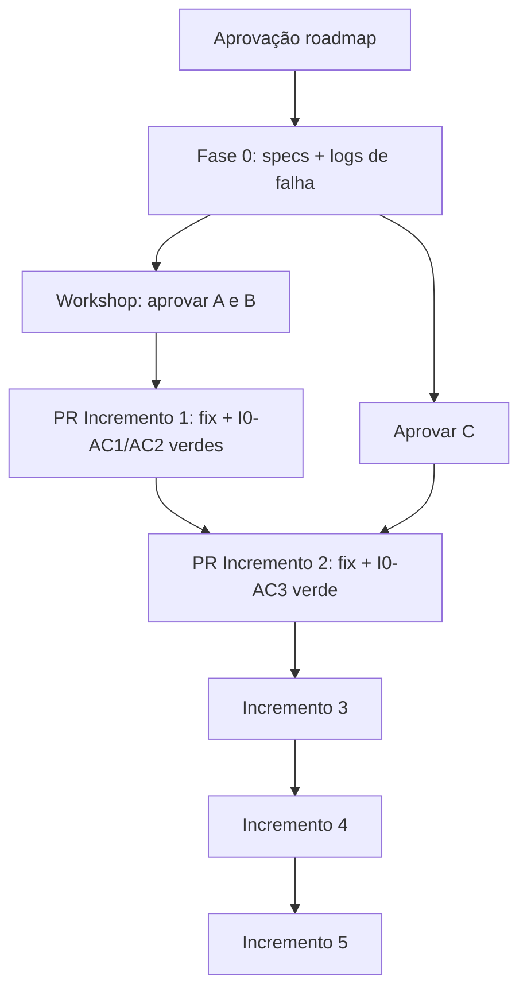

# 06 — Plano de Execução

**Revisão:** 2026-11-02 (consolidado) · **Aprovação produto:** 2026-11-02 — A1, B3, C1 (`decisions/product-approval-2026-11-02.md`)  
**Regra de integração:** branch **main** permanece com **CI verde**; testes de regressão entram no **mesmo PR** que a correção.

**Bloqueios para PR na main:** Fase 0 concluída (Inc 1); Inc 1 integrado (Inc 2). **Decisões A/B/C:** aprovadas — não bloqueiam mais planejamento. **Implementação Inc 1+:** aguarda autorização explícita além do registro de produto (2026-11-02 limitou-se a Fase 0 + docs).

---

## Sequência recomendada



**Paralelismo:** workshop A/B/C durante Fase 0; Incremento 1b (404 UI) no fechamento do Inc 1.

**Não paralelizar:** fixes de expiração e sequencial no mesmo PR (`reminder-scheduler.service.ts`).

---

## Fase 0 — Diagnóstico (passos)

| Passo | Ação | Saída |
|---|---|---|
| 0.1 | Revisar specs existentes (`reminder-scheduler.service.spec.ts`, `documents.service.spec.ts`) | Gap confirmado (9 tests pass, sem cobertura dos 3 bugs) |
| 0.2 | Redigir três specs (I0-AC1..3) em branch local | Arquivos prontos para Inc 1/2 |
| 0.3 | Executar `pnpm --filter api test -- <spec paths> --no-coverage` | Log com **FAIL** esperado |
| 0.4 | Gravar log em `reports/roadmap/evidence/inc0-repro-log-YYYY-MM-DD.md` | I0-D2 |
| 0.5 | Registrar no AI Memory (comando + trecho de saída) | Rastreabilidade |
| 0.6 | **Não** abrir PR na main só com testes vermelhos | Main verde |

**Gate de saída Fase 0:** I0-D1..D4 (`04-acceptance-criteria.md`).

---

## Gate antes do Incremento 1 (primeiro PR na main)

| Item | Owner | Status |
|---|---|---|
| Decisões **A1** e **B3** | Produto | **Aprovado** 2026-11-02 |
| Matriz A1 em `04` | PM/Tech | **Preenchida** |
| Fase 0 concluída (I0-D*) | Eng | Pendente |
| Autorização de **implementação** Inc 1 | Produto | Pendente (fora do escopo da aprovação 2026-11-02) |

**Conteúdo do PR Incremento 1 (quando autorizado)**

1. Fix expiração parcial conforme **A1** (`expired` + `document.expired`; sem `completed` fantasma).
2. **B3:** remover/ocultar `closureMode` manual na UI; não expor `closeDocument`; depreciar método.
3. Testes **I0-AC1** verde; critérios **I1-AC3** (B3) — I0-AC2 permanece evidência Fase 0 do defeito histórico de `closeDocument`.

**Validação:** I1-AC1..I1-AC6; `pnpm --filter api test` + lint verdes.

---

## Gate antes do Incremento 2

| Item | Owner | Status |
|---|---|---|
| Decisão **C1** | Produto | **Aprovado** 2026-11-02 |
| Incremento 1 na main, CI verde | Eng | Pendente |
| Autorização implementação Inc 2 | Produto | Pendente |

**PR Incremento 2:** fix elegibilidade lembrete + teste **I0-AC3** verde + I2-AC1..AC3.

---

## Incrementos 3–5

| Incremento | Gate | Entrega mínima |
|---|---|---|
| 3 | Inc 1+2 estáveis | Reenvio + auditoria |
| 4 (fatias) | Por fatia | Ver `03` |
| 5 | Inc 1+2 | KPI, job integridade, runbook E1–E6 |

---

## Runbook E2E manual (Incremento 5)

Ver tabela E1–E6 na revisão anterior; executar com evidência anexada. Mobile permanece UNVERIFIED até execução.

---

## Riscos de execução

| Risco | Mitigação |
|---|---|
| A/B atrasadas | Fase 0 + workshop com `02` |
| Testes vermelhos na main | Política C-03 em `07` |
| Legado `completed` fantasma | Comunicado; remediação fora do MVP |

---

## Revisão final (atualizada)

### 1. Primeiro trabalho a executar

**Fase 0 — Diagnóstico e evidência** (não exige merge na main).

### 2. Por que primeiro

Captura prova executável dos defeitos **sem** bloquear CI; desbloqueia PRs de fix com testes já escritos.

### 3. Decisões antes da Fase 0

**Nenhuma** (A1, B3, C1 já aprovadas 2026-11-02). Antes do **Incremento 1 na main:** Fase 0 concluída + autorização de implementação.

### 4. Como provar Fase 0 concluída

I0-D1..D4 + arquivo em `reports/roadmap/evidence/` + registro AI Memory com comandos e falhas esperadas.

### 5. Fora da Fase 0

Merge de testes falhando; correções; UI; demais incrementos.

---

## Comandos úteis

```bash
pnpm --filter api test -- reminder-scheduler.service.spec.ts --no-coverage
pnpm --filter api test -- documents.service.spec.ts --no-coverage
pnpm --filter api lint
```

**Evidência baseline (revisão 2026-11-02):** `reminder-scheduler.service.spec.ts` — 9 passed, 0 failed (suíte atual não cobre os três bugs).

---

## Próximo passo

1. **Eng:** executar **Fase 0** → `reports/roadmap/evidence/inc0-repro-log-2026-11-02.md`.  
2. **Produto:** quando desejar código na main, autorizar **implementação Incremento 1** explicitamente (além do registro 2026-11-02).  
3. **Não** implementar Incrementos 1+ até essa autorização e Fase 0 concluída.
