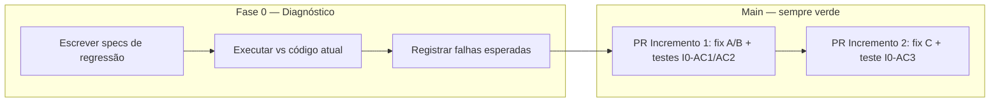

# 07 — Prontidão para Execução

**Revisão do planejamento:** 2026-11-02 · **Aprovação produto:** 2026-11-02 (A1, B3, C1)  
**Estratégia:** Reliability First · **Código de referência:** `37c8036`

---

## 1. Inconsistências encontradas

| ID | Inconsistência | Onde aparecia | Risco |
|---|---|---|---|
| INC-01 | Incremento 0 pedia testes que **falham** integrados na main **antes** do Incremento 1, conflitando com CI verde por entrega | `03` § Inc 0 AC9/DoD; `04` I0-AC1..3; `06` passo 0.7 (“vermelhos intencionais”) | Bloqueio de merge, PRs vermelhos permanentes, falsa sensação de “entrega concluída” |
| INC-02 | `04` Definition of Ready do Inc 1 citava “branch Incremento 0 merged com testes falhando conhecidos” | `04` linha 194 | Reforçava INC-01 |
| INC-03 | Incremento 0 descrito como **entrega independente** com DoD de PR “só testes”, mas critério de sucesso era falha — papel confuso vs fase de diagnóstico | `03`, `06` | Time não saberia quando fechar Inc 0 |
| INC-04 | Recomendações A/B/C em `02` podiam ser lidas como decisões aprovadas | `02` § Recomendação | Implementação antecipada de regra de negócio |

**Não identificada inconsistência** na ordem 1→2→3 (expiração/fechamento antes de sequencial no mesmo arquivo `reminder-scheduler.service.ts` justifica PRs separados, não ordem invertida).

---

## 2. Correções realizadas no planejamento

| Correção | Decisão de plano |
|---|---|
| **C-01** | Incremento 0 redefinido como **fase de diagnóstico e evidência** — não é merge na main com testes vermelhos. |
| **C-02** | Testes de regressão dos três defeitos são **escritos e executados** na Fase 0; falhas registradas em artefato (`reports/roadmap/evidence/` + AI Memory). |
| **C-03** | **Integração na main:** cada teste entra **no mesmo PR** que a correção correspondente, já **verde**. |
| **C-04** | Mapeamento: I0-AC1 + I0-AC2 → **Incremento 1** (após decisões A e B); I0-AC3 → **Incremento 2** (após decisão C). |
| **C-05** | DoD global reforçado: **CI verde** ao final de toda entrega integrada. |
| **C-06** | `02` ganhou seção **“Recomendação ≠ aprovação”** e tabela de impacto por alternativa. |
| **C-07** | Critérios I0-* renomeados para **I0-D*** (diagnóstico); critérios de merge movidos para I1/I2. |

---

## 3. Modelo de entrega (CI verde)



**Regra:** nenhum commit na branch principal deixa a suíte vermelha de propósito. Evidência de defeito vive **fora** da main (log, branch efêmera, anexo de ticket) até o fix.

---

## 4. Decisões de negócio — status (atualizado 2026-11-02)

| Decisão | Alternativa aprovada | Data | Bloqueia planejamento | Bloqueia implementação |
|---|---|---|---|---|
| **A** | **A1** | 2026-11-02 | Não | Inc 1 (até Fase 0 + autorização) |
| **B** | **B3** | 2026-11-02 | Não | Inc 1 (até Fase 0 + autorização) |
| **C** | **C1** | 2026-11-02 | Não | Inc 2 (até Inc 1 + autorização) |

Registro completo: `decisions/product-approval-2026-11-02.md`. Recomendações históricas em `02` **não** substituem este registro.

### Obrigações resumidas para implementação futura

**A1:** parcial no prazo → `expired`; preservar assinaturas; `document.expired`; sem `document.completed`; sem PDF parcial auto; UI não “concluído”.

**B3:** sem manual na UI; sem rota `closeDocument`; método deprecado; só fechamento automático.

**C1:** lembrete sequencial só signatário ativo com `notifiedAt`; paralelo — convidados elegíveis.

---

## 4b. Decisões de negócio — histórico pré-aprovação (referência)

| Campo | Conteúdo |
|---|---|
| **Necessidade** | Definir status, PDF e eventos quando `expiresAt` passa e existe ≥1 assinatura |
| **Alternativas** | A1 expired + evento; A2 completed/parcial + PDF obrigatório; A3 expired + PDF sob demanda; A4 status quo (defeito) |
| **Recomendação documentada** | Rejeitar A4; preferir A1 salvo exigência legal de PDF parcial auto (então A2) |
| **Impacto técnico** | A1: cron chama `markExpired`/evento, sem `completed` fantasma. A2: estender `finalizeEnvelope` para parcial. A3: endpoint download condicional. A4: nenhuma mudança (inaceitável para Reliability First) |
| **Impacto funcional** | UI/copy, download, webhooks, expectativa do remetente |
| **Incremento bloqueado** | **Incremento 1** (implementação) |

### Decisão B — Fechamento manual

| Campo | Conteúdo |
|---|---|
| **Necessidade** | `closureMode` + `closeDocument` sem rota/PDF |
| **Alternativas** | B1 fechar = finalizar; B2 encerrar sem completed falso; B3 ocultar/deprecar manual; B4 manter dívida |
| **Recomendação documentada** | B3 curto prazo; se manual visível → B1 |
| **Impacto técnico** | B1/B2: unificar closure com finalize; B3: UI/settings + alinhar ou remover método; B4: risco latente |
| **Impacto funcional** | Wizard settings, promessa de “fechamento manual” |
| **Incremento bloqueado** | **Incremento 1** |

### Decisão C — Sequencial (convite vs lembrete)

| Campo | Conteúdo |
|---|---|
| **Necessidade** | Quem pode receber lembrete no modo sequencial |
| **Alternativas** | C1 só signatário da vez convidado; C2 mínimo `notifiedAt` obrigatório; C3 anti-padrão |
| **Recomendação documentada** | C1; C2 mínimo aceitável |
| **Impacto técnico** | Filtro em `processEnvelopeReminders` / `sendReminderIfDue` |
| **Impacto funcional** | Menos e-mail indevido; contador de 3 lembretes preservado |
| **Incremento bloqueado** | **Incremento 2** (aceite final; diagnóstico I0-AC3 não exige C) |

### Decisões secundárias (explicitamente não bloqueiam Fase 0)

Reenvio, cancelamento, cooldown — Incrementos 3–4. Ver `02-business-decisions.md`.

---

## 5. Sequência final dos incrementos

| Ordem | ID | Nome | Integra na main? | Decisão prévia |
|---|---|---|---|---|
| 0 | Fase 0 | Diagnóstico e evidência | **Não** (apenas artefatos de evidência opcionais em `evidence/`) | Nenhuma |
| 1 | Inc 1 | Integridade A1 + B3 (+ teste I0-AC1 verde; I1-AC3 B3) | **Sim** | A1 + B3 aprovadas; Fase 0; autorização implementação |
| 1b | Inc 1b | UI erro 404 PDF (opcional) | Sim | Pode seguir Inc 1 |
| 2 | Inc 2 | Sequencial C1 (+ teste I0-AC3 verde) | **Sim** | C1 aprovada; Inc 1 na main |
| 3 | Inc 3 | Convites / reenvio | Sim | Regras secundárias |
| 4 | Inc 4 | Autonomia (fatias) | Sim | Por fatia |
| 5 | Inc 5 | Observabilidade + runbook | Sim | Inc 1–2 estáveis |

Ordem **1 → 2 → 3 → 4 → 5** preservada. Fase 0 **precede** Inc 1 em calendário, mas **não** precede em merge.

---

## 6. Primeiro trabalho pronto para desenvolvimento

| Pergunta | Resposta |
|---|---|
| **Primeiro trabalho** | **Fase 0 — Diagnóstico e evidência** |
| **Pronto agora?** | **Sim** — **Fase 0 liberada** pela aprovação 2026-11-02; A1/B3/C1 definem critérios dos PRs futuros |
| **Primeiro PR na main** | **Incremento 1** — após Fase 0 (I0-D*) + **autorização explícita de implementação** (não incluída na aprovação de produto 2026-11-02) |
| **Primeiro PR com testes novos verdes** | Incremento 1 (I0-AC1 + I1-AC3); Incremento 2 (I0-AC3 + C1) |

---

## 7. Critérios para avançar entre incrementos

| De → Para | Condição objetiva |
|---|---|
| **Fase 0 → Inc 1** | I0-D1..D4 cumpridos; **A1/B3** já aprovadas; **autorização de implementação** Inc 1 |
| **Inc 1 → Inc 2** | I1-AC* cumpridos; CI verde; **C1** já aprovada; autorização implementação Inc 2 |
| **Inc 2 → Inc 3** | I2-AC1..I2-AC4 cumpridos (I2-AC5 opcional); CI verde |
| **Inc 3 → Inc 4** | I3-AC1..I3-AC4 cumpridos; I3-AC5 checklist se escopo incluir UI |
| **Inc 4 → Inc 5** | Fatias 4a–4e acordadas entregues ou explicitamente adiadas |
| **Inc 5 → operação** | I5-AC1..I5-AC4; runbook E6 executado com evidência |

---

## 8. Resumo executivo por incremento (pós-revisão)

### Fase 0 — Diagnóstico e evidência

| Dimensão | Conteúdo |
|---|---|
| Objetivo | Provar executavelmente que os três defeitos existem **sem** quebrar CI na main |
| Problema | Falta de specs de regressão e evidência rastreável |
| Incluído | Authoring specs; execução local/branch; log de falhas; link para critérios futuros I1/I2 |
| Excluído | Merge de testes vermelhos; fix de produção |
| Dependências | Nenhuma decisão de negócio |
| Aceite | I0-D1..D4 (`04`) |
| Evidência | Arquivo em `reports/roadmap/evidence/inc0-repro-log-YYYY-MM-DD.md` + AI Memory |
| Concluído quando | Três falhas documentadas + specs prontos para copiar/colocar no PR de fix |

### Incremento 1 — Integridade da conclusão

| Dimensão | Conteúdo |
|---|---|
| Objetivo | Eliminar `completed` sem artefato/eventos nos caminhos expiração parcial e fechamento manual |
| Problema | `processExpiredEnvelope`, `closeDocument` |
| Incluído | Fix conforme A/B; testes I0-AC1/AC2 **verdes no mesmo PR**; eventos; opcional 1b UI 404 |
| Excluído | Lembrete sequencial |
| Dependências | **A, B aprovadas**; Fase 0 concluída |
| Aceite | I1-AC* |
| Evidência | CI verde; asserts de evento/PDF |

### Incremento 2 — Sequencial

| Dimensão | Conteúdo |
|---|---|
| Objetivo | Lembretes só para elegíveis no sequencial |
| Problema | `notifiedAt ?? 0`, cron ignora `signingMode` |
| Incluído | Fix C; teste I0-AC3 **verde no mesmo PR** |
| Excluído | Cobrar agora |
| Dependências | **C aprovada**; Inc 1 recomendado |
| Aceite | I2-AC* |

### Incrementos 3–5

Sem alteração material de escopo; ver `03-prioritized-roadmap.md`. Todo merge exige CI verde.

---

## 9. Informação não confirmada no repositório nesta revisão

| Item | Status |
|---|---|
| Comportamento em produção FlowDeploy | UNVERIFIED (Discovery) |
| Nomes exatos de colunas SQL em Postgres prod | Entidade usa `finalFileKey` (camelCase TypeORM); SQL em `05` é hipótese |
| Specs I0-AC1..3 ainda **não existem** no repo | Confirmado: `reminder-scheduler.service.spec.ts` passa 9 testes e **não** cobre sequencial `notifiedAt` null nem expiração parcial sem finalize |
| Páginas AI Memory `notes/discovery-2026-11-02-*` | Query retornou hits; leitura integral falhou escopo MCP em sessão anterior |
| CI GitHub Actions falha com testes vermelhos | Não executado nesta revisão; princípio CI verde é requisito de plano |

**Comando executado nesta revisão:**

```bash
pnpm --filter api test -- reminder-scheduler.service.spec.ts --no-coverage
```

**Resultado:** PASS — 9 tests, 0 failures (confirma ausência de regressão dos três bugs na suíte atual).

---

## 10. Checklist de validação final (consolidado)

- [x] Roadmap, aceite e execução alinhados após correção INC-01..04  
- [x] Nenhuma orientação para integrar testes permanentemente falhando na main  
- [x] Decisões **A1, B3, C1** aprovadas 2026-11-02 (`decisions/product-approval-2026-11-02.md`)  

---

## 11. Próximo passo recomendado

1. **Engenharia:** executar **Fase 0** (autorizada) → `reports/roadmap/evidence/inc0-repro-log-2026-11-02.md`.  
2. **Produto:** quando for iniciar código na main, emitir **autorização explícita de implementação** do Incremento 1 (fora do escopo da aprovação de políticas 2026-11-02).  
3. **Não** abrir PR Incremento 1 até Fase 0 concluída + autorização de implementação.
